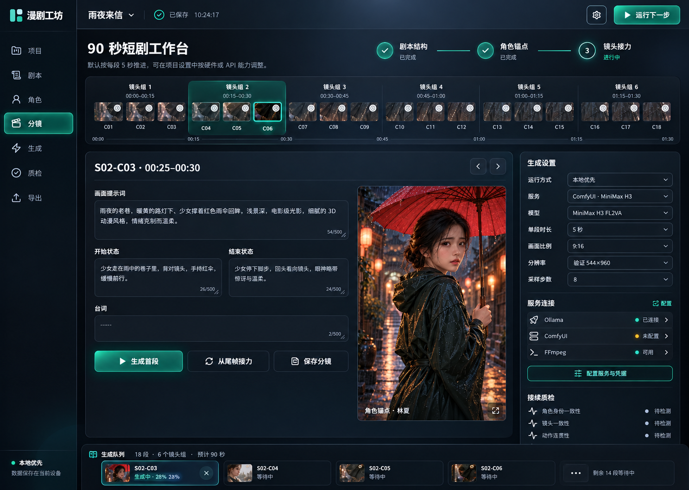

# AI Comic Drama Workbench · 漫剧工坊

[](https://github.com/bourboncx/ai-comic-drama-workbench/actions/workflows/ci.yml)
[](LICENSE)
[](https://nodejs.org/)
[](#项目状态)

本地优先、模型可替换、节点可关闭的 AI 漫剧 / 短剧生产工作台。

默认把一集 90 秒短剧拆成 18 个 5 秒片段，围绕“首段生成 → 抽尾帧 → 下一段接力 → 连续性质检 → 后期 → 导出 → 多平台发布”组织成一条可配置工作流。



## 为什么做这个项目

AI 视频模型越来越多，但真正制作连续短剧时，困难通常不在“生成一个片段”，而在于：

- 怎么把剧本稳定拆成可执行分镜；
- 怎么在几十个片段甚至几十集之间保持角色一致；
- 怎么处理尾帧接力、重复帧和拼接跳变；
- 怎么同时兼容本机工作流和付费云 API；
- 怎么把配音、字幕、质检、导出与媒体发布放进同一条流程。

漫剧工坊提供一个可运行、可配置的控制台，把这些环节组织起来。外部能力不可用时，增强节点可以关闭或回退，不会破坏主工作流。

## 核心能力

- **90 秒分段工作流**：默认 18 × 5 秒，也可按模型能力自定义总时长和单段时长。
- **首尾帧接力**：为“首段生成 → 抽尾帧 → 下一段续写 → 去重拼接”保留完整状态和质检入口。
- **系列角色库**：身份版本、参考图组、服装版本、声线、负面约束和身份阈值按系列保存。
- **本地与 API 分离**：本地模型显示硬件档位；云 API 不绑定本机显存。
- **可关闭节点**：配音、字幕、BGM、多语、剪映工程等增强节点可以独立关闭。
- **本机凭据管理**：环境变量优先，本机 JSON 回退；浏览器只接收掩码和来源。
- **8 平台同步发布**：通过 MatrixMedia GUI 的本机 HTTP API 发布到抖音、视频号、B站、百家号、头条、快手、小红书和番茄视频。
- **响应式 AI 控制台**：桌面与移动端均可使用，适合逐步接入真实模型与服务。

## 模型与服务

| 类型 | 已配置适配入口 |
| --- | --- |
| 剧本 / 分镜 | Ollama、OpenAI 兼容接口、自定义 HTTP |
| 本地视频 | MiniMax H3、Wan 3.0、HunyuanVideo 1.5，经 ComfyUI 执行 |
| 云端视频 API | MiniMax H3、Seedance 2.5、Kling 3.0 / 4.0、Vidu Q3 / Q4、Runway Gen-4.5、Gemini Omni Flash |
| 后期与辅助 | FFmpeg、MoneyPrinterTurbo、VideoLingo、NarratoAI、FunClip |
| 媒体发布 | MatrixMedia GUI HTTP API |

> 模型目录、参数约束、凭据保存和调用前校验已经实现。真实生成仍需要安装对应本地模型、导入 ComfyUI 工作流，或配置服务商 API 凭据。

## 工作流

```text
主题 / 剧本
  → Ollama 结构化剧本与分镜
  → 系列角色库注入身份锚点
  → 关键帧与首个视频片段
  → FFmpeg 抽取尾帧
  → 下一段接力生成
  → 身份 / 锚点 / 动作连续性质检
  → 配音 / 字幕 / BGM / 多语
  → 去重、统一帧率、拼接与编码
  → MP4 / SRT / JSON / 剪映工程
  → MatrixMedia 多平台发布
```

## 快速开始

### Windows 一键启动

双击：

```text
启动漫剧工坊.bat
```

脚本会检查 Node.js、首次安装依赖、启动本机服务并打开浏览器。

### 命令行启动

```powershell
git clone https://github.com/bourboncx/ai-comic-drama-workbench.git
cd ai-comic-drama-workbench
npm install
npm run dev
```

打开 <http://127.0.0.1:4173>。

生产构建：

```powershell
npm run build
npm run preview
```

更完整的安装与服务配置见 [快速开始文档](docs/QUICKSTART.md)。

## 凭据与本地配置

复制模板：

```powershell
Copy-Item config/keys.example.json config/keys.local.json
Copy-Item config/integrations.example.json config/integrations.local.json
```

也可以直接在“服务与模型”抽屉中修改并保存。

服务端读取顺序：环境变量 → `config/keys.local.json` → 未配置。

本地文件已加入 `.gitignore`，不会被提交。请不要把真实 API Key 写入示例文件、Issue、日志或截图。

## MatrixMedia 同步发布

本项目只使用 MatrixMedia GUI 提供的 localhost HTTP API，不复制其平台自动化代码，也不调用 CLI。

1. 单独下载并启动 [MatrixMedia](https://github.com/hanliang97/MatrixMedia) GUI；
2. 在 MatrixMedia 中登录媒体账号；
3. 在本项目“服务与模型 → 节点引擎”中启用 `MatrixMedia 矩媒`；
4. 保持默认地址 `http://127.0.0.1:30088`；
5. 在“拼接与导出”中勾选需要发布的平台。

默认先保存到各平台草稿箱。本项目不会读取或保存媒体账号密码、Cookie 和登录会话。

MatrixMedia 采用 GPL-2.0，独立安装、独立运行；其许可证与发布逻辑归原项目所有。

## 项目状态

当前为 **Alpha / 可运行原型**：

- 页面、流程编排、角色库、模型目录、配置持久化、连接测试和媒体发布代理可运行；
- 生成队列目前包含演示状态机，尚未为每个视频提供方完成真实任务提交与轮询；
- FFmpeg 的抽尾帧、重复帧检测和最终拼接仍需要继续实现为真实任务；
- 真实模型输出质量和角色一致性需要按具体工作流进行评测。

欢迎从适配器、ComfyUI 工作流、质检算法和真实生成任务执行器开始贡献。

## 文档

- [快速开始](docs/QUICKSTART.md)
- [架构与数据流](docs/ARCHITECTURE.md)
- [贡献指南](CONTRIBUTING.md)
- [安全说明](SECURITY.md)

## 技术栈

- React 19 + Vite 6
- Express 5
- Lucide React
- Ollama / ComfyUI / FFmpeg
- 可插拔云模型 API 与 Sidecar 服务

## 贡献

Issue、文档修正、模型适配器和工作流实现都很欢迎。提交前请阅读 [CONTRIBUTING.md](CONTRIBUTING.md)，并确保 `npm run check` 能够通过。

## 许可证

本项目代码采用 [MIT License](LICENSE)。

第三方模型、API、开源工具和平台服务受各自许可证、服务条款与内容政策约束。本项目不隶属于 MiniMax、字节跳动、快手、Google、Runway、Vidu、MatrixMedia 或任何媒体平台。
